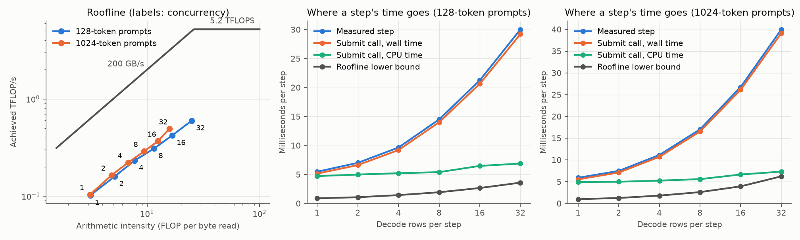

# WeSolve: a swarm of Meta AI agents that makes vLLM faster on a Mac

> WeSolve, an agent swarm, sped up a mixture-of-experts LLM (Meta's MobileMoE-S) on a local Apple Silicon Mac (M1 Pro, vLLM) by up to 21% end to end, prompt reading and generation together (430 → 519 tokens/s), with bit-identical output. Generation alone got up to 27% faster, and prompt reading up to 11%.

<sub>32 concurrent requests, 256 new tokens each, medians of 5 runs against vLLM as shipped: 1,024-token prompts 430 → 519 tokens/s (+21%), 128-token prompts 911 → 1,097 (+20%). In the 1,024-token run unchanged vLLM was slower than in earlier runs; against MLX's compiled code, timed alongside, that gain is 11% (see *Limits*).</sub>

An indie-track project for the Meta Global AI Developer Hackathon (Oct 26 – Nov 4, 2026).

**What we did.** We built **WeSolve**, a swarm of AI agents running Meta's own models (Muse Spark and Muse Wonder) in Meta's coding agent, Muse Code. We pointed it at vLLM serving Meta's on-device model MobileMoE-S on an Apple M1 Pro. The swarm read the code and our measurements, found where the time goes, and wrote new GPU kernels for the model's mixture-of-experts layers. With its best kernels, **a whole request, reading the prompt and generating the answer, finishes up to 21% faster with 32 concurrent requests**. Generation alone is up to 27% faster and prompt reading up to 11%, and every answer stays the same, token for token.

**How WeSolve works, in plain words.** One agent can look at one thing at a time; a team can look at everything at once. WeSolve splits the problem among many agents: explorers each study a different part of the code, a verifier checks what they claim, several builders compete to write the fix, and a lead coordinates. They all write in shared notebooks, so each one sees what the others found and changes course when someone else's finding points to a better path. Nothing counts until a referee has measured it: the new code must give exactly the same answers and be faster in the real engine. Each round starts from what the last one learned.

## Results

**What we measure: the whole request.** A request has two phases:
- **prompt reading** (prefill): the model processes the prompt;
- **generation** (decode): it produces 256 new tokens, one decode step at a time.

Our benchmark times the whole request, from sending the requests to the last generated token, and each phase on its own. An improvement only counts if one phase gets faster and neither gets slower.

The best version, **WeSolve**, is the swarm's experts and routing kernels from round 4, the last ([how they were measured](claude/findings/muse-round-4.md)). Against vLLM as shipped, medians of 5 runs:

| Requests × prompt tokens | Whole request, generated tokens/s | Generation only, tokens/s | Prompt reading time |
|---|---|---|---|
| 1 × 128 | 156 → 165 (**+6%**) | 164 → 173 (+6%) | 65 → 69 ms (+7%, within the spread between runs) |
| 8 × 128 | 491 → 533 (**+9%**) | 516 → 574 (+11%) | 232 → 215 ms (−7%) |
| 32 × 128 | 911 → 1,097 (**+20%**) | 1,004 → 1,233 (+23%) | 855 → 838 ms (−2%) |
| 32 × 1,024 | 430 → 519 (**+21%**) | 710 → 899 (+27%) | 7.66 → 6.85 s (−11%) |

The whole-request column counts the 256 generated tokens per request over the full time, prompt reading included. Generation only counts the decode steps.

**Against other ways to run the model.** Whole requests, prompt reading included, in generated tokens per second:

| Requests × prompt tokens | MLX alone | MLX + WeSolve | vLLM original | vLLM + compiled MLX code | **vLLM + WeSolve** |
|---|---|---|---|---|---|
| 1 × 128 | 174 | 169 | 156 | 160 | **165** |
| 8 × 128 | 479 | 526 | 491 | 487 | **533** |
| 32 × 128 | 994 | 1,169 | 911 | 914 | **1,097** |
| 32 × 1,024 | 504 | 554 | 430 | 468 | **519** |

Generation only, decode steps:

| Requests × prompt tokens | MLX alone | MLX + WeSolve | vLLM original | vLLM + compiled MLX code | **vLLM + WeSolve** |
|---|---|---|---|---|---|
| 1 × 128 | 203 | 221 | 164 | 169 | **173** |
| 8 × 128 | 522 | 587 | 516 | 512 | **574** |
| 32 × 128 | 1,086 | 1,334 | 1,004 | 1,005 | **1,233** |
| 32 × 1,024 | 837 | 1,014 | 710 | 757 | **899** |

- **Against compiled MLX code**, WeSolve's whole requests are 3%, 9%, 20% and 11% faster.
- **With 8 and 32 requests,** vLLM + WeSolve serves more tokens per second than MLX alone.
- **With 1 request, MLX alone is fastest.** vLLM spends about 2 ms of engine CPU time per single-request step.

**Memory bandwidth used during generation.** Bytes each decode step must read (the weights of the experts it uses, the other weights and the attention cache, as counted in the [baseline](#baseline-results)) divided by the step's time, against the M1 Pro's peak of about 200 GB/s:

| Requests × prompt tokens | vLLM original | vLLM + WeSolve |
|---|---|---|
| 1 × 128 | 29.3 GB/s (15%) | 31.0 GB/s (16%) |
| 32 × 128 | 22.6 GB/s (11%) | 27.7 GB/s (14%) |
| 32 × 1,024 | 27.7 GB/s (14%) | 35.1 GB/s (18%) |

WeSolve turns more of the bandwidth into tokens, but the engine still uses less than a fifth of it. [The study below](#the-study-where-does-the-memory-bandwidth-go) shows where the rest goes.

**Conditions.**
- **Hardware:** Apple M1 Pro, 16-core GPU, 16 GB unified memory, about 200 GB/s peak memory bandwidth and 5.2 TFLOPS; macOS 15.7.4, on AC power.
- **Model:** `facebook/MobileMoE-S-QAT`, Meta's int4 on-device mixture-of-experts model: about 1.3B parameters, about 272M used per token; 20 layers, 60 experts per layer, 4 per token ([GLOSSARY.md](claude/GLOSSARY.md)).
- **Engines:** vLLM 0.32.0 with vllm-metal 0.32.0.dev20261028121433 and MLX 0.32.4. *MLX alone* is mlx_lm running the model directly, one batch at a time, with no server; it doesn't time prompt reading on its own, so it appears in the whole-request and generation tables only.
- **Workloads:** 1, 8 or 32 requests at once, random-token prompts of 128 or 1,024 tokens, 256 generated tokens each, greedy decoding.
- **Repeats:** 5 shuffled runs per cell for vLLM, 3 for MLX alone; medians.
- **Exactness:** every variant gave exactly the unchanged model's tokens, checked with 1 and 32 requests in both engines.
- **The columns:**
  - *compiled MLX code* is the same two parts of the model under MLX's own compiler (`mx.compile`), with no new kernel. It shows what the swarm's kernels add beyond compiling.
  - *WeSolve* is `muse-spark/round-4/kernels/experts/attempt-1` with `routing/attempt-1`.

**Limits.**
- **The 1,024-token baseline ran slow.** In this run, unchanged vLLM took 45.1 ms per decode step with 32 requests of 1,024 tokens, against 39.4 to 40.9 ms in earlier runs. Its gains there are likely a few points high. Against compiled MLX code, timed in the same run, WeSolve is 11% faster on whole requests and 19% on generation. With 128-token prompts the baseline was normal, and the gain is 20% against both.
- **Prompt reading with 1 request** was 6.8% slower by median. Its runs spread from 51 to 85 ms, against WeSolve's 57 to 70, so the difference is inside the noise. With 8 and 32 requests, prompt reading got faster.
- **Our own acceptance rule isn't met.** It asks the 5 runs' ranges not to overlap the bars' in any workload. On this machine, which had 16–17 GB of swap in use, they overlap somewhere for every variant. No measurement is slower beyond the spread.
- **The engines ran one after the other,** not interleaved, so compare across them with care.

The data is in [results/runs/2026-11-04-muse-round-4/](results/runs/2026-11-04-muse-round-4/) (vLLM) and [results/runs/2026-11-04-muse-round-4-mlx/](results/runs/2026-11-04-muse-round-4-mlx/) (MLX alone). To reproduce the vLLM run, about 45 minutes:

```bash
K=muse-spark/round-4/kernels
.venv/bin/python bench/grader/time_candidates.py vllm results/runs/<date>-check \
  experts=$K/experts/attempt-1 routing=$K/routing/attempt-1 \
  --variant muse-experts-routing:experts=$K/experts/attempt-1+routing=$K/routing/attempt-1 \
  --variant compiled-experts-routing:experts=compiled+routing=compiled
```

## What the swarm built, round by round

WeSolve ran four rounds on 2026-11-03 and 04. Each wrote in its own folder, `muse-spark/round-<N>/` (round 1 at the top of `muse-spark/`), started from the rounds before it, and was then measured independently by Claude.

| Round | Model | What happened | Measured |
|---|---|---|---|
| 1 | Muse Spark | Its kernels passed the first grader, but in the model they changed the generated tokens. The grader now asks for bit-exact outputs at every size ([ADR 0010](claude/adr/0010-exact-at-every-size.md)). | [round 1](claude/findings/muse-round-1.md) |
| 2 | Muse Wonder | Exact kernels. Routing sped up decode steps but slowed prompts by 7–10%. An improvement must now hold in both phases ([ADR 0011](claude/adr/0011-decode-and-prefill.md)). | [round 2](claude/findings/muse-round-2.md) |
| 3 | Muse Spark (contributor) | The swarm ran the same end-to-end measurement itself before calling anything ready ([ADR 0013](claude/adr/0013-measure-what-you-claim.md)). Its routing + combine pair shortened decode steps by 1.6–16.5%, with nothing slower. | [round 3](claude/findings/muse-round-3.md) |
| 4 | Muse Wonder | With a new rule, kernels may hand the sizes they lose at to MLX's own code ([ADR 0015](claude/adr/0015-sets-and-hand-off-below.md)). That unlocked the experts kernel: 31% faster than compiled MLX at 8 and 32 rows. Experts + routing is the best version, above. | [round 4](claude/findings/muse-round-4.md) |

- **What the kernels do:**
  - The **experts kernel** fuses each token's routed experts into one GPU kernel for 2 to 59 rows, the decode sizes, and hands 1-row steps and prompts to MLX's own code.
  - The **routing kernel** picks each token's 4 experts in one kernel, bit-exact with MLX's choice, ties included.
- **A limit we found:** all three swarm kernels together (experts, routing and combine) lose 8% with 8 requests, though every pair gains there. That is why the best version is a pair.

## The study: where does the memory bandwidth go?

**The question:** when vLLM serves Meta's on-device MobileMoE-S model on an Apple M1 Pro, how much of the GPU's memory bandwidth does it actually use, where does the remaining time go, and which fixes turn unused bandwidth into more tokens per second?

Each measured decode step is plotted against two limits: peak bandwidth (~200 GB/s) and peak compute (~5.2 TFLOPS). One request at a time should be limited by bandwidth. Running more requests per step reuses the weights already read, until compute becomes the limit. In a mixture-of-experts model, each extra request may also pull in different experts, so the bytes read grow too. Terms are defined in [GLOSSARY.md](claude/GLOSSARY.md).

**What we found** ([results below](#baseline-results)): unchanged vLLM serves MobileMoE-S at 12–17% of the GPU's peak memory bandwidth, and each decode step takes 6–8 times longer than the bandwidth and compute limits require. Microbenchmarks show where the time goes ([claude/findings/decode-bottlenecks.md](claude/findings/decode-bottlenecks.md)):

- about 870 small GPU kernels per step, each with a fixed cost;
- expert weights read once per (token, expert) pair;
- attention reading each key/value head three times.

A piece-by-piece measurement inside the real step, in vLLM and plain MLX side by side, is in [claude/findings/step-breakdown.md](claude/findings/step-breakdown.md):
- vLLM's scheduler and runner are small, 0.5–1.6 ms per step.
- vLLM's extra 7–20% over plain MLX is in vllm-metal's attention path.
- With one request, the mixture-of-experts block's routing and combine cost more than its expert products. With 32 requests, the routed experts take half the step.
- Piece by piece, only the output layer gets near peak bandwidth (about 160 GB/s with one request).
- The GPU's own counters, recorded with Xcode, show the GPU busy 92–98% of the time at only 17–28% of peak bandwidth, with most of its thread slots empty.
  - With one request each weight is read once.
  - With 32 requests a step reads about twice what the model needs: the routed experts read 908 MB from memory for 443 MB of weights. MLX's split quantized products also write about 170 MB of partial sums per step.

[claude/findings/bottleneck-explained.md](claude/findings/bottleneck-explained.md) explains where the bottleneck is in plain English, with each number worked through from its inputs. These findings are what WeSolve's agents started from.

## How Meta's models are used

- **MobileMoE-S** (open weights) is the model under study, served by vLLM through vllm-metal. The baseline serves the int4 `facebook/MobileMoE-S-QAT` ([why](claude/adr/0002-int4-qat-baseline.md)); the bfloat16 `facebook/MobileMoE-S-SFT` is used to check the port.
- **The Muse agent** works in **Muse Code**, Meta's own coding agent, started only with `tools/muse-agent/start.sh`: **Muse Spark** (`muse-spark-1.3-contributor`; Meta Model API) in rounds 1 and 3, **Muse Wonder** (`muse-wonder-1.0`; Meta Model API) in rounds 2 and 4.
  - Each round follows the skill [.agents/skills/muse-round/SKILL.md](.agents/skills/muse-round/SKILL.md). In it, the Muse agent works as a swarm:
    - explorers, one per part of the code or the measurements, write a shared analysis;
    - competing builders write fused GPU kernels for the top inefficiencies and run the grader on them;
    - the lead coordinates and commits.
    
    Both phases are tracked live in shared documents in the round's folder: `muse-spark/exploration/` and `muse-spark/implementation/` for round 1, `muse-spark/round-<N>/` for each later round. [How the swarm works](claude/muse-swarm.md), with diagrams.
  - From round 2 on, a round starts from the earlier rounds' results, and each new kernel must beat its slot's best so far, where one passes the current grader. A finished round's files are frozen (tag `muse-round-<N>`).
  - Its work goes to `muse-spark/` on the branch `muse-agent`, with the transcripts of its sessions. Its task was committed and tagged `agent-era` ([brief](claude/muse-agent-brief.md)); the move to Muse Code and the skill were committed and tagged `muse-code-era` before its first Muse Code session.

## Who made what

Every commit is made by **surucuonur**. The co-author on each commit shows whose work it holds:

| Who | What | Where |
|---|---|---|
| **surucuonur** | Direction, decisions, running the machine, starting the Muse agent's sessions | every commit |
| **Claude Code** (Claude Opus 5.5) | Benchmark, grader and provenance code, measurements, write-ups, the Muse agent's brief and round skill | `bench/`, `claude/`, `tools/`, `.agents/skills/`, this README. Commits co-authored by `claude`. |
| **The Muse agent**, in Muse Code: Muse Spark (`muse-spark-1.3-contributor`) in rounds 1 and 3, Muse Wonder in rounds 2 and 4 | Its analysis, hypotheses, kernels, phase logs and session transcripts | `muse-spark/`, on the branch `muse-agent`. Commits co-authored by "Muse Spark" (rounds 1 and 3), "Muse Wonder" (rounds 2 and 4). |
| **Others, before the event** | vLLM, vllm-metal, mlx-lm, MLX, Meta's model weights | `third_party/` at pinned commits, plus the installed wheels |

Git hooks refuse commits that mix the two, and `tools/provenance_check.py` audits the whole history. [PROVENANCE.md](PROVENANCE.md) gives the details and the commands to check them.

## Layout

```
PROVENANCE.md         who made what, and how to check it
claude/               everything Claude Code wrote, apart from this README
claude/GLOSSARY.md    shared vocabulary
claude/adr/           decisions and why
claude/benchmark/     baseline benchmark write-up: findings, every measurement, method
claude/findings/      where a decode step's time goes, and the fixes it suggests
muse-spark/           the Muse agent's work: round 1 at the top, round-<N>/ for later rounds, and the session transcripts (branch muse-agent)
.agents/skills/       the round skill the Muse agent follows in Muse Code (written by Claude)
third_party/          pinned submodules: vllm-metal and mlx-lm (forks, where changes go), vLLM v0.32.0 (read-only)
bench/                benchmark sweep, roofline calculation, port correctness check
bench/micro/          microbenchmarks of a decode step's parts
bench/grader/         the independent grader for the Muse agent's kernels
tools/                provenance hooks and audit; the Muse agent's launcher
results/runs/         every benchmark run, committed
results/traces/       Metal GPU traces (large, not committed)
```

## Setup

Requirements: Apple Silicon, macOS 15 or later, [uv](https://docs.astral.sh/uv/), and Hugging Face access to `facebook/MobileMoE-S-SFT`. Full Xcode 26.2 or later is only needed to record GPU counters (`bench/micro/gpu_counters.py`), open GPU traces and rebuild vllm-metal's kernels.

```bash
git clone --recurse-submodules https://github.com/surucuonur/meta-hackathon.git
cd meta-hackathon
uv venv .venv --python-preference only-managed --python cpython-3.12-macos-aarch64 --seed
source .venv/bin/activate
uv pip install "https://github.com/vllm-project/vllm/releases/download/v0.32.0/vllm-0.32.0%2Bcpu-cp38-abi3-macosx_11_0_arm64.whl"
uv pip install "https://github.com/vllm-project/vllm-metal/releases/download/v0.32.0.dev20261028121433/vllm_metal-0.32.0.dev20261028121433-cp312-cp312-macosx_15_0_arm64.whl"
uv pip install --no-deps -e third_party/mlx-lm
uv pip install -e bench/steplog matplotlib
```

Python must be native arm64. An Intel Python running under Rosetta can't install these wheels, so `--python` forces uv's own arm64 build. The vllm-metal wheel is the prebuilt release of the commit pinned in `third_party/vllm-metal`. The editable `mlx-lm` install is the fork where the MobileMoE port lives.

vllm-metal's own tools (for example `tools/check_parity.py`) import the submodule's source, which has no compiled kernels until it is built with Xcode. Until then, copy them from the wheel (same commit; the files are git-ignored in the submodule):

```bash
W=.venv/lib/python3.12/site-packages/vllm_metal
for f in $(cd $W && ls metal/*.metallib metal/_paged_ops.* pytorch_backend/_mps_ops.*so pytorch_backend/_mps_ops.torch-version); do
  cp "$W/$f" "third_party/vllm-metal/vllm_metal/$f"
done
```

`.env` is not committed. It holds `MODEL_API_KEY` for Muse Spark on Meta's API (round 1) and `HUGGINGFACE_API_KEY` for downloading the gated model; the scripts pass the second one to Hugging Face tools as `HF_TOKEN`.

The int4 model is converted to MLX's format once. The serving copy has bfloat16 scales; the float32 copy keeps the scales exact for the correctness check. Both go to `models/` (git-ignored):

```bash
.venv/bin/python bench/convert_qat.py                   # needs HF_TOKEN for the first download
.venv/bin/python bench/convert_qat.py --dtype float32
```

### Port check

No inference engine supported MobileMoE, so it is ported to mlx_lm (`third_party/mlx-lm/mlx_lm/models/mobilemoe.py`). `bench/check_port.py` compares the port with Meta's PyTorch code on fixed prompts. Meta's code needs transformers 4.57 and mlx-lm needs 5.7 or newer, so the reference runs in a second environment:

```bash
uv venv .venv-ref --python-preference only-managed --python cpython-3.12-macos-aarch64 --seed
uv pip install --python .venv-ref/bin/python torch "transformers==4.57.6" numpy jinja2 safetensors
for dtype in float32 bfloat16; do
  .venv-ref/bin/python bench/check_port.py ref --dtype $dtype
  .venv/bin/python bench/check_port.py mlx --dtype $dtype
done
```

float32 is the correctness gate: same greedy tokens, same top-1 token at every position, and logits within 0.01. bfloat16 is a sanity gate: the port's error against the exact answer must stay within 1.5x of the reference's own bfloat16 error. Summaries go to `results/port/`. For the int4 model, the same steps run with `--model facebook/MobileMoE-S-QAT` and the converted copies (commands in `bench/check_port.py`).

| Model | float32 gate | bfloat16 gate (worst error ratio) |
|---|---|---|
| MobileMoE-S-SFT | PASS, logits within 0.0001 | PASS (1.18) |
| MobileMoE-S-QAT (int4) | PASS, logits within 0.0001 | PASS (1.43; the bfloat16 scales round each group of 32 weights together) |

A second check confirms that serving through vLLM gives the same tokens as plain mlx_lm, because vllm-metal runs its own attention code instead of the port's: 0 failures in 80 requests for both models ([SFT](results/port/MobileMoE-S-SFT-serving-parity.md), [QAT](results/port/MobileMoE-S-QAT-serving-parity.md)).

## Baseline results

The unmodified engine (vLLM 0.32.0, vllm-metal 0.32.0.dev20261028121433, mlx 0.32.4) serving MobileMoE-S-QAT on an M1 Pro (16-core GPU, 16 GB, macOS 15.7.4, on AC power). Random-token prompts of 128 or 1,024 tokens, 256 generated tokens each, 1 to 32 requests in flight. Every point ran 3 times in shuffled order. All files are in [results/runs/2026-10-29-baseline/](results/runs/2026-10-29-baseline/), with the [full table](results/runs/2026-10-29-baseline/summary.md). The full write-up, with every measurement and how it was made, is in [claude/benchmark/](claude/benchmark/).



Steady decode steps only (no prompt tokens in the step). "MB read" is what the step must read: the weights of the experts its rows use, the rest of the weights, and the rows' attention cache. "Lower bound" is the step time at peak bandwidth or peak compute, whichever is slower.

| Prompt | Requests | Step ms | Decode tok/s | Distinct experts / layer | MB read | GB/s (% of peak) | CPU ms in step submit | Lower bound ms |
|---:|---:|---:|---:|---:|---:|---:|---:|---:|
| 128 | 1 | 5.5 | 182 | 4.0 | 179 | 32.6 (16%) | 4.7 | 0.9 |
| 128 | 4 | 9.7 | 414 | 12.6 | 290 | 30.0 (15%) | 5.2 | 1.5 |
| 128 | 16 | 21.3 | 753 | 29.1 | 535 | 25.2 (13%) | 6.5 | 2.7 |
| 128 | 32 | 30.0 | 1,065 | 38.2 | 720 | 24.0 (12%) | 6.9 | 3.6 |
| 1024 | 1 | 5.9 | 169 | 4.0 | 197 | 33.3 (17%) | 5.0 | 1.0 |
| 1024 | 32 | 40.0 | 800 | 32.9 | 1,248 | 31.2 (16%) | 7.3 | 6.2 |

What the data shows:

- **No step is bandwidth-bound or compute-bound.** Achieved bandwidth stays at 24–34 GB/s for every setting, and each step takes 6–8 times its lower bound. In the terms of [GLOSSARY.md](claude/GLOSSARY.md), the baseline is overhead-bound everywhere.
- **Batching helps, but each extra request costs a lot.** With 128-token prompts, 32 requests give 5.9 times the tokens per second of one request. The step grows by about 0.8 ms per request, while the bytes it must read grow by about 17 MB per request, which takes 0.09 ms at peak bandwidth.
- **With one request, the CPU and the GPU are both near their limit.** vllm-metal's step-submit call uses 4.7 ms of CPU time in a 5.5 ms step, so even a perfect GPU would leave the step near 5 ms.
- **With more requests, the GPU work sets the pace.** The CPU time grows only to 7 ms at 32 requests. The rest of the submit call is waiting, and macOS reports the GPU busy for 90–100% of every run. The GPU has work queued almost all the time, but that work moves only about 30 GB/s.

Where the time goes, from microbenchmarks run after the sweep ([claude/findings/decode-bottlenecks.md](claude/findings/decode-bottlenecks.md)):

- **Kernel count.** vLLM itself adds 7–20%, mostly in vllm-metal's attention path ([step-breakdown.md](claude/findings/step-breakdown.md)). Each step is about 870 small GPU kernels with a fixed cost each.
- **Expert reads.** MLX reads each expert's weights once per (token, expert) pair, because it picks its grouped kernel only from 60 rows per step.
- **Attention.** vllm-metal's grouped-query attention kernel doesn't support MobileMoE-S's 12/4 head layout, so the keys and values are read three times.

The weight layout of Meta's experts is not the main cause.

Limits of these numbers:

- **Swapping:** the Mac swapped out 0–7,567 pages/s during runs (322 pages/s idle). One run (128-token prompts, 16 requests) was 7% slower than its repeats during the heaviest swapping; the medians above are robust to it.
- **Bytes:** activations are not counted, and the GPU-busy figure is macOS's device-wide counter, which says the GPU had work, not how efficiently it ran.
- **Prompts:** they are random tokens. Expert routing on real text may pick different numbers of distinct experts.

Reproduce (about 35 minutes):

```bash
.venv/bin/python bench/sweep.py --label baseline
.venv/bin/python bench/roofline.py results/runs/<date>-baseline
```

`bench/steplog` is a vLLM plugin that records every engine step (requests advanced, prompt tokens, context read, time in the step-submit call); `bench/sweep.py` runs the grid against a real `vllm serve`, then repeats it once with distinct-expert counting on; `bench/roofline.py` turns the logs into the table and chart.
