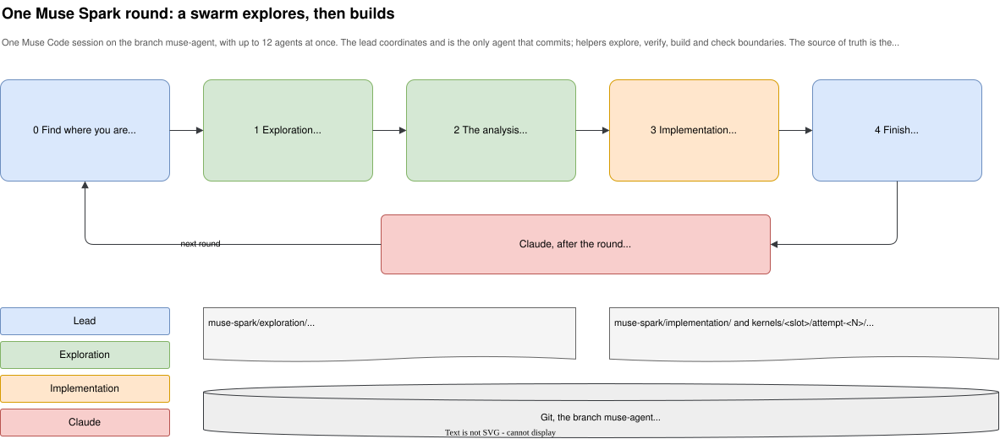
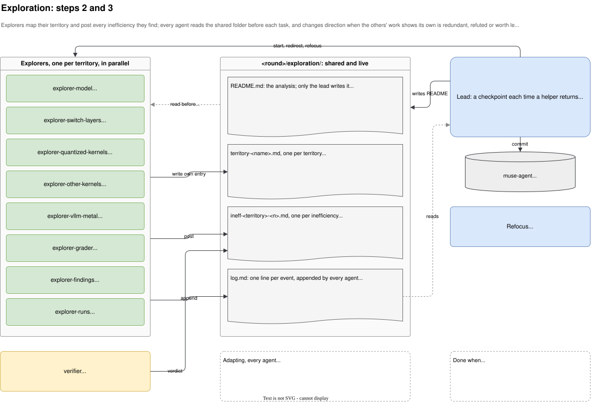
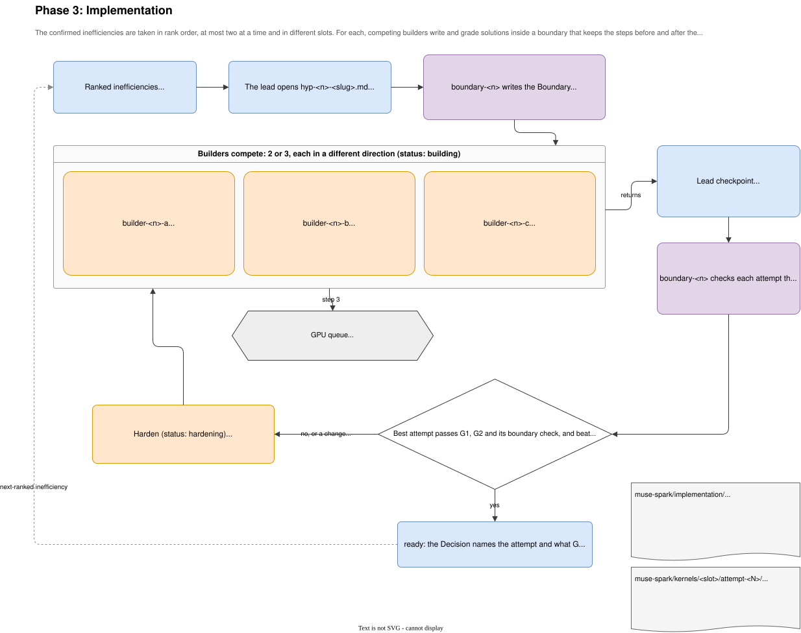

# How the Muse agent's swarm works

*Written by Claude Code (Claude Opus 5.5), directed by surucuonur. [Who made what](../PROVENANCE.md).*

The Muse agent, Meta's model working in Muse Code (Muse Spark in round 1, Muse Wonder Full from round 2; [ADR 0008](adr/0008-muse-wonder.md)), improves the MobileMoE-S decode step as a **swarm**: several agents in one Muse Code session, each covering part of the problem, sharing what they find in documents that all of them read. This page explains how one round runs, step by step, and where to watch it.

- **The source of truth** is the round skill, [.agents/skills/muse-round/](../.agents/skills/muse-round/SKILL.md), at version 6. This page describes it.
- **Why it is built this way:** [ADR 0007](adr/0007-muse-spark-swarm.md) records the decision.
- **The diagrams:** [diagrams/muse-swarm.drawio](diagrams/muse-swarm.drawio) opens in draw.io, with one page each for the overview, exploration and implementation. The images below are exported from it.

## The round at a glance



A round is one Muse Code session on the branch `muse-agent`, with up to 12 agents at once. It writes everything in its own **round folder**: round 1 at the top of `muse-spark/`, round N in `muse-spark/round-<N>/`, written `<round>/` below.
- **Exploration:** the agents first map the code and the measurements, and agree on where the time goes.
- **Implementation:** they then build and grade kernels against the causes they confirmed.
- **Claude's measurement:** after the round, Claude merges the branch and measures the results independently (G3), and the next round starts from those results (see *Rounds build on each other*).

| Role | How many | What it does | What it writes |
|---|---|---|---|
| **Lead** | 1 | Starts the helpers, keeps the two phase READMEs current, settles clashes, commits | the READMEs, hypothesis entries, `summary.md`; every commit |
| **Explorer** | 8 to start | Maps one **territory** of the code or the measurements and posts the **inefficiencies** it finds | its territory entry, its inefficiency entries, notes on others' entries |
| **Verifier** | 1 | Checks every inefficiency against its sources and confirms or refutes it | the verdict and status of inefficiency entries |
| **Builder** | 2–3 per hypothesis | Writes one solution, grades it, and reports the result: one **attempt** | its attempt folder, its section of the hypothesis entry |
| **Boundary agent** | 1 per hypothesis | Writes down what a solution must keep unchanged, and checks passing attempts against it | the hypothesis entry's Boundary and Boundary checks |

## Exploration



1. **The lead opens the phase.** It writes `<round>/exploration/README.md` with its version line (v1, skill version 6), a tracker table and an empty log, and commits it as `exploration v1`. From round 2 on, the README opens with the round's **starting point** (see *Rounds build on each other*).
2. **The explorers and the verifier start at once,** one explorer per territory. Round 1 started with eight:
   - **Code:**
     - the model's layer around the slots (`mobilemoe.py`);
     - the routed experts (`switch_layers.py`);
     - MLX's quantized kernels (`quantized.h`);
     - MLX's other kernels in the slots (sort, softmax, reductions);
     - vllm-metal's decode path around the model;
     - the grader's slot interface.
   - **Measurements:** Claude's findings with the breakdown run, and the other runs.

   From round 2 on, the starting point picks the territories: each slot's baseline kernels, the difference between Claude's G3 and the piece timing, and only those round-1 territories it reopens.
3. **Each explorer maps its territory.** It fills a checklist for every piece of code: callers, callees, data, neighbours, cost and invariants, each line with a source. It follows calls and buffers into neighbouring territories as far as it needs to, and leaves what it learns there as a note. That is how the swarm sees the whole system, not just isolated files.
4. **It posts every inefficiency it finds,** as its own entry, giving:
   - where in the code it is;
   - the cost at 1, 8 and 32 rows (kernels × the fixed cost per kernel, or bytes ÷ peak bandwidth);
   - its kind: overhead-, bandwidth- or compute-bound;
   - the saving if it were removed.
5. **Agents adapt to each other.** Before every new task and after every post, an agent reads the tracker and the newest log lines. It changes direction when another entry already covers its item, when the claim its work rests on was refuted, or when an unowned item predicts a larger saving. It logs why. Round 1 shows all of these:
   - `explorer-vllm-metal` found its two inefficiencies already posted by other explorers. It marked its own superseded, and added its engine-side detail to theirs.
   - `explorer-grader` and `explorer-other-kernels` added notes to existing entries rather than post duplicates.
   - `explorer-quantized-kernels` retracted a note when its premise turned out wrong.
6. **The verifier checks each open inefficiency.** It opens the cited lines, finds the table row and redoes the arithmetic, then marks the entry confirmed or refuted. Nothing is built on an unchecked claim.
7. **The lead runs a checkpoint each time a helper returns:**
   1. it reads the log;
   2. it settles clashes, such as two entries on one cause;
   3. it refreshes the tracker;
   4. it raises the README's version;
   5. it commits.
   
   When one file turns out to hold most of a territory's cost, the lead splits it off with its own explorer.
8. **Exploration ends** when every territory is done and every inefficiency is confirmed, refuted or superseded. The lead then writes the final **analysis**, `exploration/README.md`:
   - context;
   - how the territories feed each other;
   - the inefficiencies inside the slots, ranked by predicted saving;
   - recommendations for causes outside the slots;
   - the refuted claims, so no one chases them again.

## Implementation



1. **Rank and choose.** The confirmed inefficiencies inside the slots are taken in order of predicted saving, at most two at a time, and in different slots so their attempts never touch.
2. **Open a hypothesis.** The lead writes `implementation/hyp-<n>-<slug>.md`: the inefficiency, the slot, and the status `boundary`.
3. **Draw the boundary.** The boundary agent writes down what the solution must keep identical, so the steps before and after the slot work exactly as before:
   - the slot's inputs and outputs, with shapes and dtypes at decode and prefill sizes;
   - the rounding points and the tie rule for the 4th and 5th expert;
   - what runs just before and after;
   - the GPU's limits.
   
   It also lists what the grader can't see. G2 checks 1, 8 and 32 rows of a decode step and 127, 1,016 and 2,048 rows of a prefill, bit for bit ([ADR 0010](adr/0010-exact-at-every-size.md)), while a real decode step can have any row count from 1 to 32.
4. **Builders compete.** Two or three builders each take a different direction from the analysis, for example fusing kernels, reading each weight byte once, or a different threadgroup shape. Each builder:
   1. claims the next attempt number with `mkdir`, which fails if another builder took it first;
   2. writes the kernels and a `notes.md` with the cause it removes and its predicted time per layer;
   3. grades the attempt with the grader. The GPU lock queues runs, so two gradings never overlap and the timings stay clean;
   4. records G1, G2 and its timings against the original and the compiled reference;
   5. if the attempt failed or missed its prediction by more than 20%, finds out why and adds the answer to the analysis.
5. **Commit and check.** When a builder returns, the lead commits its attempt as the next implementation version. The boundary agent then checks every attempt that passed G2 for what the grader can't see: other row counts, threadgroup memory read before it is written, and results that depend on thread timing.
6. **Harden or close.**
   - **Harden:** if the best attempt still has a cause that can be named and removed, a builder makes its next single change.
   - **Ready:** once it passes G1, G2 and its boundary check, and beats the compiled reference at 1, 8 and 32 rows and any baseline, the hypothesis is `ready`. Its Decision states what G3 should show.
   - **Dropped:** a hypothesis that doesn't pay off is `dropped`, with the reason.
7. **Next, and finish.**
   - Then comes the next-ranked inefficiency. There is no attempt limit; the lead ends the phase when it judges no remaining inefficiency will pay, and says why.
   - The round finishes with both READMEs final, including a **Ready to test** section naming the attempt per slot that goes to G3.
   - `<round>/summary.md` gets a round section: the model, the skill version, the final attempts and the number of graded attempts per slot.

## Rounds build on each other

From round 2 on, a round starts where the earlier ones stopped ([ADR 0009](adr/0009-rounds-build-on-each-other.md)).
- **Finished rounds are frozen.** After a round's transcripts are committed, Claude tags its last commit `muse-round-<N>` (round 1: `muse-round-1`). The hooks then refuse any change to that round's files, and new files anywhere but the current round's folder and the transcripts.
- **The starting point.** The lead first reads the earlier rounds' final documents, the best attempts' notes and Claude's G3 report on the previous round. It writes the plan at the top of the round's exploration README:
  - per slot, the best attempt so far that passes G2 and that Claude's G3 accepted, the **baseline**, or where there is none, the attempt to start from; and how its G3 effect compared with its prediction;
  - what is left to build;
  - the refuted claims;
  - the territories to explore again.

  Without Claude's report the round stops.
- **The baseline is the bar.** Where a slot has one, a new attempt must beat it in the same grader run (`check_candidate.py --baseline`). The two are timed in alternating repeats, and the attempt must win at least 22 of 30 at each row count. A slot that nothing beats keeps its baseline for G3. A slot without one is measured against the compiled reference, as in round 1.

## Shared documents and versions

Each phase folder, `<round>/exploration/` and `<round>/implementation/`, holds three kinds of document:

| Document | Written by | Holds |
|---|---|---|
| `README.md` | the lead only | the version line, the tracker table, the phase's analysis or report, and `## Versions`, its changelog |
| entries (`territory-*`, `ineff-*`, `hyp-*`) | the owner; others add notes under `## From other agents` | a status block (owner, status, version, updated, next) and the content |
| `log.md` | every agent, appending one line per event | time, agent, and what happened |

Every version is raised by a single writer, so no number is taken twice:
- **Phase versions.** Each checkpoint raises the README's version and is exactly one commit, whose subject names it: `<name>: exploration v5: …`, for example `Muse Wonder: exploration v5: …` in round 2. `git diff` between two version commits shows what changed.
- **Entry versions** are raised by the entry's owner, by the verifier with its verdict, or by the lead for hypothesis entries.
- **The skill's own version** is in its header and its [changelog](../.agents/skills/muse-round/CHANGELOG.md), and each round records the version it ran.

## What keeps it honest

- **Placement.** The Muse agent writes only in its round's folder in `muse-spark/`, on `muse-agent`, and only the lead commits, always with its model's co-author. A finished round's files can't change. The git hooks refuse anything else, and [tools/provenance_check.py](../tools/provenance_check.py) re-checks the whole history.
- **Sources.** Every number in the shared documents has a source: a file and line, a table row, a grader verdict, or arithmetic shown in full.
- **Attempts.** Every graded attempt is committed and counted, so a result can't hide how many tries it took.
- **The GPU.** The grader is the only GPU job, and runs queue through [bench/grader/gpu_lock.py](../bench/grader/gpu_lock.py).
- **Independent measurement.** After the round, Claude merges the branch with `--no-ff`, re-runs G1 and G2, and runs G3 independently ([PROVENANCE.md](../PROVENANCE.md)).

## Following a round live

From the main checkout, while a round runs:

```bash
tail -f ../Hackathon-muse/muse-spark/round-2/exploration/log.md      # every event, as it happens (round 2)
tail -f ../Hackathon-muse/muse-spark/round-2/implementation/log.md   # once implementation starts
git log --oneline main..muse-agent                           # every checkpoint, one per version
```

- **The trackers:** `../Hackathon-muse/muse-spark/round-2/exploration/README.md` and its implementation counterpart show who is on what, their status, and the current version.
- **An agent's current work:** open its entry.

## Where each part is defined

| Part | File |
|---|---|
| The lead's procedure | [SKILL.md](../.agents/skills/muse-round/SKILL.md) |
| Shared documents, versions, adapting rule, rules for every agent | [tracking.md](../.agents/skills/muse-round/tracking.md) |
| Role instructions | [explorer.md](../.agents/skills/muse-round/explorer.md), [verifier.md](../.agents/skills/muse-round/verifier.md), [builder.md](../.agents/skills/muse-round/builder.md), [boundary.md](../.agents/skills/muse-round/boundary.md) |
| The task, slots and pass criteria | [muse-agent-brief.md](muse-agent-brief.md), as changed by [ADR 0006](adr/0006-muse-spark-in-muse-code.md) and [ADR 0007](adr/0007-muse-spark-swarm.md) |
| The launcher (model and sign-in, worktree, own home folder, 12 agents) | [tools/muse-agent/start.sh](../tools/muse-agent/start.sh) |
| Session transcripts | [tools/export_transcript.py](../tools/export_transcript.py), into `muse-spark/transcripts/` |
